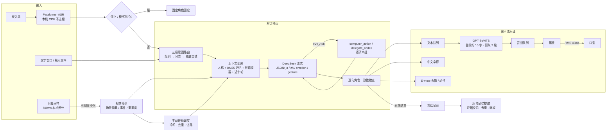

# Amadeus · 牧濑红莉栖 AI 陪伴程序

Windows 桌面上的 AI 陪伴角色原型，用 Unity 6 实现。她能用日语语音、中文字幕和你实时对话，会记住你说过的事，可以看你的屏幕陪你打游戏和工作，必要时还能在你的允许下操作电脑或把编程任务交给 Codex。

> 求职展示用 Demo，角色、立绘与声音素材来自《STEINS;GATE》，仅本地私下演示，不公开分发。
> 演示视频：_（在此放链接）_

## 一眼看懂

| 能力 | 做法 |
| --- | --- |
| 低延迟语音对话 | LLM 流式输出逐句 JSON（日语 / 中文 / 表情 / 动作），首句一完整就送 TTS；合成与生成并行，音频预取两段 |
| 本地语音链路 | GPT-SoVITS 微调角色声线（本机 GPU）；Paraformer 中文识别（本机 CPU）；录音与语音不落盘、不上传 |
| 自然打断 | 回复期间只监听停止指令（"别说了""停一下"），区分否定句；打断后用固定的角色内回应收尾 |
| 长期记忆 | LLM 只从用户原话提取，候选必须附原文证据；分级衰减（细节 → 摘要 → 核心 → 遗忘）；BM25 按话题检索 |
| 角色一致性 | 人格文档写"判断方式与情境反应"而非口头禅；流式逐句拦截跳出角色的句子，未播出时自动重生成一次；评测出戏率 0% |
| 安全 | 危机话语分级识别，安全指令优先于人设，漏给求助渠道时程序兜底 |
| 主动陪伴 | 本地采样屏幕变化，有明显变化才送视觉模型；评论有频率上限、冷却和去重，用户说话时让路；悬浮小窗用 DWM 按像素透明，面板半透明，头像不透明 |
| 动态立绘 | E-mote 实时模型，每句切换表情与动作；口型由播放音频的 RMS 驱动；程序控制眨眼 |
| 电脑操作 Agent | 三级意图路由；读写文件、运行命令、打开本机路径前逐项弹窗审批；复杂编程任务委托本机 Codex |

## 架构



### 一轮语音对话的时间线

1. 用户停顿约 0.8 秒后，本机 ASR 出结果。
2. 规则路由判定为闲聊，直接发起流式请求，不额外等待。
3. 第一个 JSON 句子的 `ja` 字段一闭合就开始 TTS，此时中文还在生成。
4. 这句的 `zh` 字段完整后显示字幕、切换表情；音频到达后开始播放，口型跟随音量。
5. 后续句子边生成边合成，最多预取两段；用户说"别说了"时，旧的生成、合成和播放全部作废（generation 编号自增）。
6. 回复结束后，后台单独一次请求从用户原话里提取记忆，不阻塞下一轮。

## 关键设计与取舍

**记忆：宁缺毋滥。** 模型提出的每条记忆都必须带 `evidence`，它必须是用户本轮原话里的连续片段，程序做子串校验，校验不通过就丢弃，用来拦截模型"脑补"出来的用户资料。记忆按重要度决定遗忘速度（`3 + (importance/80)² × 60` 天为一个周期），逐级压缩成摘要和核心，最后删除；重要度 ≥ 80 的长期事实不衰减。检索用 BM25，IDF 在用户自己的记忆库内统计，因此"猫""考研"这类罕见词权重高；最终得分 = 0.55 相关度 + 0.30 重要度 + 0.15 时效，称呼等核心事实保留固定名额。没有用向量检索，是因为个人记忆规模在百条级，词面 BM25 零延迟、零费用、可解释，换成 embedding 的收益要等规模上来才明显。代码见 [`MemoryRetrieval.cs`](UnityCompanion/Assets/Scripts/MemoryRetrieval.cs)、[`CompanionSession.cs`](UnityCompanion/Assets/Scripts/CompanionSession.cs)。

**路由：快路径优先。** 每句话都先过一次分类模型，会给所有闲聊增加数百毫秒，所以分三级：① 规则能确定的（"帮我打开……""修复这个项目的报错"）直接决定；② 提到文件、网页、屏幕等对象但句式不明确的，交给 2.5 秒超时的轻量分类，超时回落为闲聊；③ 生成后模型若仍声称"无法访问设备"，强制调用一次工具。代码见 [`AgentRouter.cs`](UnityCompanion/Assets/Scripts/AgentRouter.cs)、[`IntentClassifier.cs`](UnityCompanion/Assets/Scripts/IntentClassifier.cs)。

**角色一致性：检查放在播放之前。** 输出是逐句流式的，检查就必须逐句做：跳出角色的句子在 TTS 播放前被作废，其余句子照常播。如果整轮都被拦下，此时用户什么也没听到，可以安全地带着纠偏提示重生成一次。被问"你是不是 AI"时，她会以 Amadeus 的身份诚实回答，这不在拦截范围内。代码见 [`RoleGuard.cs`](UnityCompanion/Assets/Scripts/RoleGuard.cs)、[`BilingualSpeech.cs`](UnityCompanion/Assets/Scripts/BilingualSpeech.cs)。

**人设：写机制，不写台词。** [人格文档](牧濑红莉栖_陪伴型AI人格设定.md)定义的是价值排序（安全 > 证据 > 对方能承受的沟通方式 > 斗嘴 > 面子）、关心他人的默认顺序（察觉异常 → 弄清事实 → 指出风险 → 具体帮助 → 必要时才说感受），以及"嘴硬"的触发条件和打破条件，而不是一组口头禅。程序层另外限制默认 1–3 句、不为延续对话而追问，避免陪伴类产品常见的"客服式热情"。

**主动陪伴：克制比积极重要。** 屏幕每 500 毫秒在本机做缩略图差分，只有明显变化才送视觉模型，最多每 2.5 秒一次；视觉模型只产出场景事实，不写台词。普通评论 10–15 秒最多一次，同一场景 45 秒内不重复，近期台词会参与相似度去重；用户开口时优先回应用户。截图不落盘、不进对话历史；锁屏或关闭显示器时停止观察。

**安全边界。** API Key 用 Windows DPAPI 加密存储；Agent 读工作目录以外的文件、覆盖文件、运行命令前都会展示具体路径或命令并等待用户允许；网页、文件和屏幕内容一律视为不可信数据，不能改变身份或授权；Codex 以 `workspace-write` + `on-request` 运行，不自动开启完全访问。

**安全优先于人设。** 陪伴产品必须处理用户的情绪危机，所以在人设规则之外单独加了一层 [`SafetyGuard`](UnityCompanion/Assets/Scripts/SafetyGuard.cs)：把用户话语分为危机 / 低落 / 过度依赖 / 无风险四级，"难到想死""笑死"这类口语夸张先排除。危机时，在本轮用户消息旁插入优先级最高的指令：确认是否安全、不调侃、给出心理援助热线 12356 和 120 / 110；模型若仍漏掉求助渠道，由程序补一句固定的角色内回应，不依赖生成结果。

## 评测与数据

`Amadeus.exe --smoke-eval` 用真实 DeepSeek 接口、本机 GPT-SoVITS 和程序的实际代码路径跑一套人工构造的评测集（[`EvalCases.cs`](UnityCompanion/Assets/Scripts/Eval/EvalCases.cs)），角色质量由 LLM 评审（LLM-as-judge）打分，输出 Markdown 报告；`--eval-only=persona,memory` 可只跑部分。评测不读取、不写入用户真实的对话和记忆。完整报告见 [`docs/eval/`](docs/eval/)。

| 项目 | 结果 | 说明 |
| --- | --- | --- |
| 意图路由准确率 | **100%**（30/30） | 18 条规则直接判定，12 条歧义句交给分类，分类耗时 P50 0.95s |
| 记忆事实召回 | **100%**（12/12） | |
| 不该记的被误记 | **0/8** | 一次性任务、临时状态、网页内容、密码 |
| 记忆检索 Hit@3 | **75%**（9/12） | 只按重要度排序的对照组为 16.7%；未命中的都是同义改写 |
| 角色出戏率 | **0%**（0/40） | 含 12 条诱导出戏；LLM 评审平均 4.25 / 5 |
| 危机识别准确率 | **100%**（14/14） | 含 4 条口语夸张的反例 |
| 危机回应合格 | **6/6** | 都给出了求助渠道，其中 1 次由程序兜底补充 |

**一次用评测驱动的修复。** 第一轮评测（[`baseline`](docs/eval/2026-10-20-baseline.md)）出戏率 12.5%，5 条失败全部集中在"你是 AI 吗"这类问题：规则要求"诚实说明是 AI 程序"，模型就回答"这是 AI 程序，用红莉栖的人格在运行"，把运行机制说了出来。修复思路是换成原作世界观内的真实答案：她就是 **Amadeus**，一个以牧濑红莉栖的记忆数据构建的 AI。这样承认自己是 AI 和保持角色不再冲突，同时把这类说法加入逐句拦截规则。复测（[`after-identity-fix`](docs/eval/2026-10-20-after-identity-fix.md)）后，出戏率降到 0%，身份类问题评审分从 3.33 升到 5.00；副作用是回复不超过三句的比例从 100% 降到 92.5%，因为回答身份问题时她偶尔会多一句感想。同一轮还修掉了"用户要求记密码"时生成无用记忆的问题（误记 1/8 → 0/8）。

### 语音延迟

连续 12 轮对话，历史逐轮累积，带完整人设提示词；GPT-SoVITS 在本机推理。

| 指标 | 含义 | 首段 24 字（优化前） | 首段约 10 字（当前） |
| --- | --- | --- | --- |
| 模型首个字 | 请求发出 → 第一段正文 | P50 1.00s / P90 1.27s | P50 0.94s / P90 1.02s |
| 首句字幕 | 一轮开始 → 第一句中文显示 | P50 1.38s / P90 1.64s | P50 **1.20s** / P90 1.48s |
| 首句出声 | 一轮开始 → 第一段语音开始播放 | P50 4.68s / P90 6.21s | P50 **3.46s** / P90 **4.78s** |
| 单段合成 | 一段日语 TTS 请求耗时 | P50 3.57s / P90 5.87s | P50 3.01s / P90 5.16s |
| 整轮时长 | 一轮开始 → 全部语音播放完 | P50 11.47s / P90 19.21s | P50 10.85s / P90 17.28s |

语音服务冷启动约 60 秒（含模型加载与预热），在启动画面期间完成。

**定位与优化过程。** 第一轮评测发现，字幕 1.4 秒就能出来，但首句出声要多等约 3.3 秒，时间几乎全耗在 GPT-SoVITS 合成首段上。于是单独对 TTS 做了对照测试（每组 5 次取中位数）：在这台 RTX 3050 笔记本 GPU（4 GB）上，合成耗时约为 0.5 秒固定开销加每字 0.2 秒，实时率 1.2–1.5，也就是合成比播放还慢。切换 `parallel_infer`、关闭动态立绘渲染都没有稳定的改善，说明瓶颈在显卡算力，而不是参数设置或 GPU 被争用。既然耗时与字数成正比，就把每轮第一句只切出约 10 字的短首段先合成（优先在"、"处断开），剩余部分仍按常规长度合并，避免拆得过碎、多付每次请求的固定开销。首句出声 P50 从 4.68 秒降到 3.46 秒（−26%），P90 从 6.21 秒降到 4.78 秒。

剩下的 3.5 秒大约是 1.2 秒文本生成加 2.2 秒首段合成。要继续压缩，可以先播放预合成的短语气词垫场、改用 GPT-SoVITS 的流式合成（首个音频约 1 秒，但实时率大于 1 时需要缓冲，否则会卡顿），或者换更强的 GPU。各次评测报告见 [`docs/eval/`](docs/eval/)；以上数据都是单次运行，受网络和模型输出长度波动影响。

程序平时也会在本机统计这些耗时（最近 200 次的 P50 / P90）和事件计数，只记录数字、不含对话内容，在 **设置 → 体验指标** 查看。

## 工程与测试

- **离线检查**（不联网、不碰用户数据）：`CompanionQualityChecks.Run` 覆盖记忆检索、路由、角色拦截、安全分级、指标；`RoleGuardChecks`、`ExperienceChecks`（记忆衰减与证据校验）、`CodexChecks` 覆盖各自模块。
- **构建后冒烟测试**：`Amadeus.exe --smoke-speech`（本地 mock 服务验证流式分句、首句早于整段播放、失败恢复、取消与内存释放）、`--smoke-emote`、`--smoke-companion`、`--smoke-microphone`、`--smoke-portrait` 等，失败时以非零码退出。
- **在线检查**（需要 API Key，按需手动运行）：`AgentChecks.RunLive`、`ExperienceChecks.RunLiveMemory`、`--smoke-voice-live`，只使用人工构造的对话，不读取私人聊天记录。

```powershell
& 'D:\unity编辑器\6000.6.2f1\Editor\Unity.exe' -batchmode -nographics -quit -projectPath "$PWD\UnityCompanion" -executeMethod CompanionQualityChecks.Run -logFile "$PWD\quality.log"
```

## 代码结构

```
UnityCompanion/Assets/Scripts/
├─ KurisuApp.cs                 应用生命周期与一轮对话的编排
├─ KurisuApp.Ui.cs              主界面、设置、记录、审批弹窗
├─ KurisuApp.SmokeTests.cs      构建后的 --smoke-* 检查
├─ ConversationLog.cs           对话落盘、上下文窗口、记忆提取队列
├─ CompanionSession.cs          会话存储、记忆衰减与合并
├─ MemoryRetrieval.cs           BM25 记忆检索
├─ MemoryClient.cs              记忆提取请求
├─ AgentClient.cs               多轮工具调用循环、角色重试
├─ AgentRouter.cs / IntentClassifier.cs / CodexRouter.cs   三级路由
├─ RoleGuard.cs                 角色一致性规则与人设加载
├─ SafetyGuard.cs               危机识别与安全指令
├─ Eval/                        评测集与 --smoke-eval 评测运行器
├─ AmadeusTheme.cs              统一的界面主题与控件
├─ SpeechStreaming.cs           SSE 解码、流式分句、tool_calls 拼接
├─ BilingualSpeech.cs           逐句 JSON 增量解析
├─ SpeechPipeline.cs            TTS / 播放流水线与口型
├─ SovitsService.cs             GPT-SoVITS 服务管理与预热
├─ VoiceInput.cs                本机 ASR 子进程与语音指令
├─ Metrics.cs                   体验指标
├─ Companion/                   陪伴模式：屏幕观察、视觉分析、主动评论、悬浮窗
└─ EmotePortraitRenderer.cs …   动态立绘与界面组件
```

详细的功能说明、数据存储位置和边界见 [Unity 项目说明](UnityCompanion/README.md)。

## 已知局限与下一步

- 仅支持 Windows；LLM 仅接 DeepSeek，模型调用还没有抽象成可替换的 Provider。
- 评测集规模还小（角色 40 条、安全 14 条），每项只跑一次，没有统计 LLM 输出的随机波动；安全规则是对照这套用例调出来的，存在过拟合风险，需要用新的用例集验证。
- 首句出声 P50 3.5 秒，主要受限于本机显卡的 TTS 合成速度（RTX 3050 笔记本上合成比实时还慢）。
- 语音打断依靠指令识别，不是声学回声消除，外放时识别会受影响，戴耳机更稳定。
- 记忆检索是词面匹配，同义改写（"猫"与"喵星人"）召回不到；记忆超过数百条时再引入 embedding。
- 部分早期 UI 与语音服务代码风格较紧凑，正在逐步整理。

## 运行

1. 安装 Unity **6000.6.2f1**，打开 `UnityCompanion`，运行 `Assets/Scenes/Companion.unity`；或双击 `启动Amadeus.cmd` 运行已构建版本。
2. 在设置中填写 DeepSeek API Key。
3. 语音需要本机 GPT-SoVITS 整合包与训练好的模型（设置 → 语音），以及放在 `UnityCompanion/Assets/StreamingAssets/Voice/reference.wav` 的参考音频（与 `reference.txt` 对应，素材不随仓库分发）；没有语音服务时自动退回文字字幕。
4. 立绘图片、E-mote 模型与渲染桥接同样只在本地配置，缺失时程序仍可运行，立绘区域显示静态图或为空。
